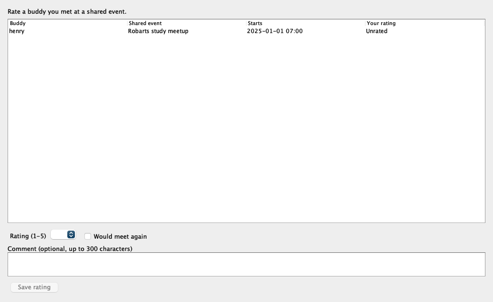
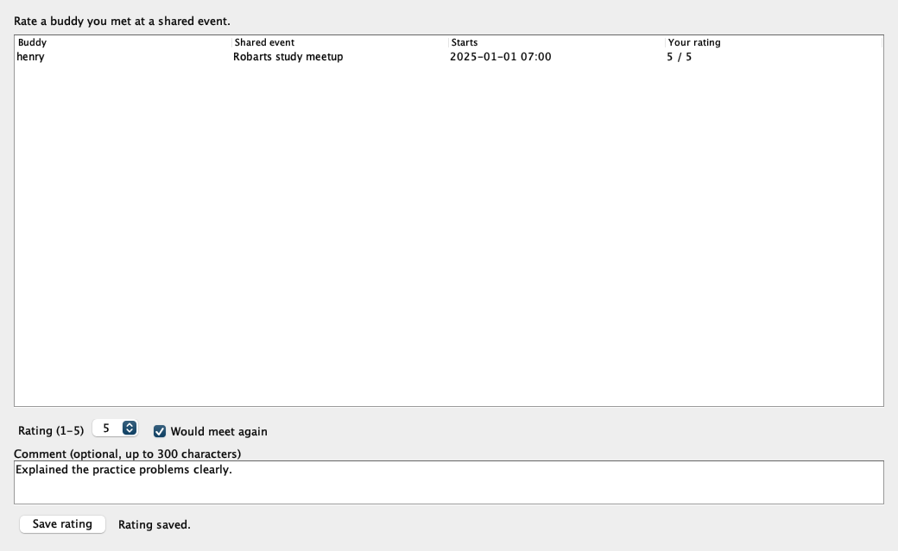
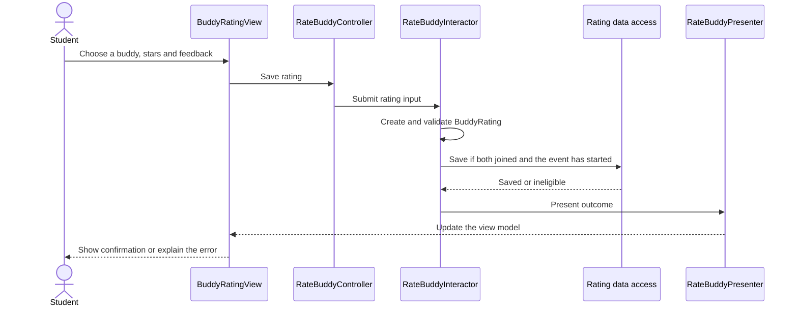

# CampusBuddy

CampusBuddy is a Java Swing app for University of Toronto students to find people to study with or join for campus activities.

## Track A MVP — student accounts

**Use case lead:** Gracie (@graceliu369).

**User story:** As a student sharing a computer, I want to create my own account, sign out when I leave, and return to the same account on my next visit.

| Use case | What the student does | Result |
| --- | --- | --- |
| Sign up | From the account screen, enter a new username and the same password twice. | A new account opens with the username as its display name. A taken name, a blank or short password, or mismatched entries leave the form open. |
| Log out | From the signed-in screen, select **Logout**. | The account screen returns. The next student must enter their own credentials. |
| Log in | From the account screen, enter an existing username and password. | Valid credentials open that student's account. Incorrect credentials leave the student signed out. |

## Track B MVP — community events and personal calendar

**Use case lead:** Lufeng Cheng.

**User story:** As a UofT student, I want to find small activities in the communities I care about, join the ones I like, and see everything I've joined on a monthly calendar with Ontario holidays, so that I can meet people without double-booking myself.

| Use case | What the student does | Result |
| --- | --- | --- |
| Browse events | Open the **Community** tab and pick a community, or **All communities**. | Upcoming and past events are listed by start time, with the organizer, spots taken out of the limit, and whether the student has joined. |
| Publish an event | Fill in the **Publish an event** form: community, title, optional description, maximum number of people (1–100), and a start time in Toronto time. | The event appears in the list for everyone. A missing title, an invalid limit, or a start time that is not in the future keeps the form as typed and explains what to fix. The organizer is not added automatically. |
| Join an event | Select an event and choose **Join event**. | The student takes one spot. Joining again changes nothing. An event that is full or has already started cannot be joined, even if two students try for the last spot at the same moment. |
| View my calendar | Open the **Calendar** tab and move between months. | Every joined event appears on its day in Toronto time, together with Ontario public holidays. |
| Export my calendar | On the **Calendar** tab, choose **Export month to .ics...** and pick a file. | The month's joined events are saved as a calendar file that Google Calendar and Apple Calendar can import. |

**External API:** [Nager.Date](https://date.nager.at/) public holidays (`GET /api/v3/PublicHolidays/{year}/CA`). CampusBuddy keeps only holidays observed in Ontario. If the API cannot be reached, the calendar still opens without holidays.

To try Track B with the demo data, run `app.Main` with the program argument `--dev-user=gracie` (any seeded user works: `james`, `herry`, `gracie`, `henry`, `alex`).

## Run the account demo

Use Java 11 and Maven. From an IDE, run `app.Main` with the program argument `--sqlite`. With Maven, run:

```sh
mvn compile org.codehaus.mojo:exec-maven-plugin:3.5.0:java -Dexec.mainClass=app.Main -Dexec.args=--sqlite
```

Register a new account, log out, close the app, and run it again from the same directory. Log in with the original password. Accounts are saved in `data/campusbuddy.db`. Launching without arguments uses the team's in-memory demo data.

Run `mvn clean verify` for the tests, including the architecture dependency check. The coverage report is generated at `target/site/jacoco/index.html`.

## Post-meetup buddy ratings

**MVP lead** — Gracie (@graceliu369).

As a student, I want to record how a meetup went and whether I would meet that buddy again, so my past experience can inform future buddy matches.

| Use case | What the student sees |
| --- | --- |
| Find a buddy to rate | **Ratings** lists other students who signed up for the same event. A row becomes available when the event starts. Select someone you actually met. |
| Rate or update a meetup | Choose 1–5 stars, indicate whether you would meet again, and optionally add a comment of up to 300 characters. Saving again updates your feedback for that buddy at that event. Each student sees only the ratings they wrote. |

### Try the ratings demo

For a quick walkthrough, run `app.Main --dev-user=gracie` and open **Ratings**. The in-memory demo includes the Post-Midterm Hotpot Hangout.

To demonstrate saving across launches, use a demo database in a separate working directory:

1. Launch `app.Main --sqlite` there and register the demo accounts `gracie` and `henry` with passwords of your choice.
2. From that directory, load the [prepared meetup](demo/rating-meetup.sql) with `sqlite3 data/campusbuddy.db < /path/to/team-project/demo/rating-meetup.sql`. This adds one shared study meetup for those accounts.
3. Log in as Gracie, open **Ratings**, select Henry at **Robarts study meetup** and save feedback. Edit the rating and save again.
4. Restart with `--sqlite` from the same directory and log back in as Gracie. The saved values return. Log in as Henry to see his own feedback form for Gracie.

### Rating walkthrough

The same student can reopen a meetup and edit their feedback.

| Before saving | After saving |
| --- | --- |
|  |  |


